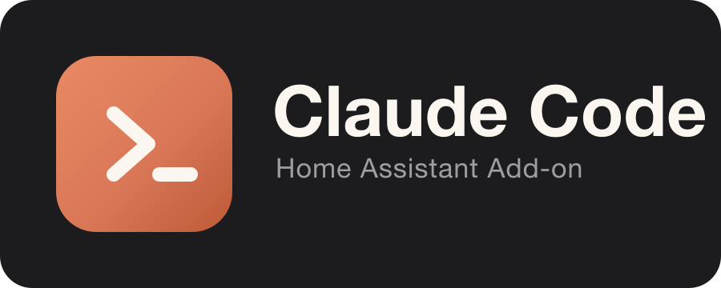
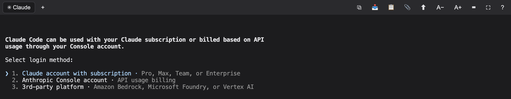
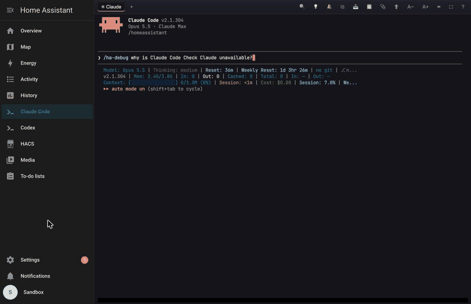

<div align="center">



# Claude Code — Home Assistant App

A Home Assistant app (formerly called an add-on) that runs Anthropic's [Claude Code](https://code.claude.com/docs) CLI as a polished web console — right in the sidebar.

[](https://my.home-assistant.io/redirect/supervisor_add_addon_repository/?repository_url=https%3A%2F%2Fgithub.com%2FLayerTM%2FClaudeInHA)

[](claude-code/CHANGELOG.md)
[](https://developers.home-assistant.io/docs/add-ons/configuration#add-on-config)
[](LICENSE)
[](https://www.home-assistant.io/)

[](claude-code/config.yaml)
[](claude-code/config.yaml)
&nbsp;
[](https://github.com/LayerTM/ClaudeInHA/actions/workflows/ci.yml)
[](.pre-commit-config.yaml)
[](https://github.com/LayerTM/ClaudeInHA/commits/main)
[](https://github.com/LayerTM/ClaudeInHA/stargazers)
[](https://buymeacoffee.com/layertme)





</div>

## Features

- **Real Claude Code CLI** — skills, plugins, MCP servers, and slash commands all work
- **Zero-prep HA toolkit** — a bundled Home Assistant skill pack (`/ha-automation`, `/ha-debug`, `/ha-screenshot`, …), general plugins (superpowers, frontend-design, …), and the `ha`/`yq`/`hass-cli` tools, all preinstalled and persisted across updates
- **Browser testing built in** — Chromium is preinstalled; screenshot any dashboard with `ha-shot`, or use the Playwright MCP for interactive checks
- **Tabs** — the Claude session alongside any number of shell tabs
- **Clipboard that works everywhere**, including plain-HTTP setups and the mobile companion app
- **Attachments** — drag & drop files, paste images, or pick from your camera/gallery
- **One-click CLI updates** without restarting the app (auto-update on start included)
- **Full Home Assistant access** — config files, REST API, Supervisor API, and (with an HA token) WebSocket
- **Session persistence** via tmux — closing the browser never kills Claude
- **Mobile-friendly** — touch key bar, full-screen kiosk mode, installable as a PWA
- **Remote Control** (optional) — drive the session from the official Claude mobile app

## Works with

- [**claude-ha**](https://github.com/LayerTM/claude-ha) — the companion integration: chat with Claude from Assist and automations through this app (HACS default repository).
- [**CodexInHA**](https://github.com/LayerTM/CodexInHA) — the same console and Assist chat for OpenAI's coding agent.

## Installation

1. Click the badge above, or add this repository yourself: **Settings → Apps →
   Install app → ⋮** (top right) **→ Repositories**, paste
   ```
   https://github.com/LayerTM/ClaudeInHA
   ```
   and click **Add**.
2. In the app store, open **Claude Code**, then **Install** and **Start**.
3. Click **Open Web UI**. Home Assistant leaves **Show in sidebar** off for every
   app it installs — turn it on in the app's **Info** tab if you want a
   **Claude Code** entry in the sidebar.

Authenticate by running `claude` in the console and following the login URL
(subscription), or set an API key / OAuth token in the configuration. See the
[documentation](claude-code/DOCS.md) for details.

## Requirements

- Home Assistant OS or Supervised (`amd64` or `aarch64`)
- A Claude subscription (Pro/Max/Team) or an Anthropic API key

## Security and privacy

The app can read and change your Home Assistant configuration, including
`secrets.yaml`, and what Claude reads in a session is sent to Anthropic. See
[Security and privacy](claude-code/DOCS.md#security-and-privacy) before you
install it.

## Documentation

Full documentation lives in the app's **Documentation** tab, or in
[`claude-code/DOCS.md`](claude-code/DOCS.md).

## Development

The app is assembled from its own sources and a pinned release of the
shared core: run `claude-code/core/assemble.sh <core archive> claude-code <dir>`
(the archive is the one named in `claude-code/core/core.lock.json`), then work
in `<dir>/app`. There, `npm test`, `npm run lint` (eslint) and
`npm run typecheck` (tsc --checkJs) must pass, as must `npm run test:alerts`
and `npm run test:config`.

From the repository root, `python .github/scripts/test_secret_scan.py` followed
by `python .github/scripts/secret_scan.py .` must be clean. CI also runs the
app linter and hadolint on `claude-code/config.yaml` and
`claude-code/Dockerfile`.

A change in behaviour bumps the version in `claude-code/config.yaml`, adds an
entry to `claude-code/CHANGELOG.md`, and updates `claude-code/DOCS.md` and this
README where they describe it. Changes to the HTTP API are additive; a change
to the wire format is agreed with the Home Assistant integration first.

## License

[MIT](LICENSE) © 2026 LayerTM

Claude and Claude Code are products of Anthropic. This is an independent,
community-maintained app and is not affiliated with or endorsed by
Anthropic or the Home Assistant project.
